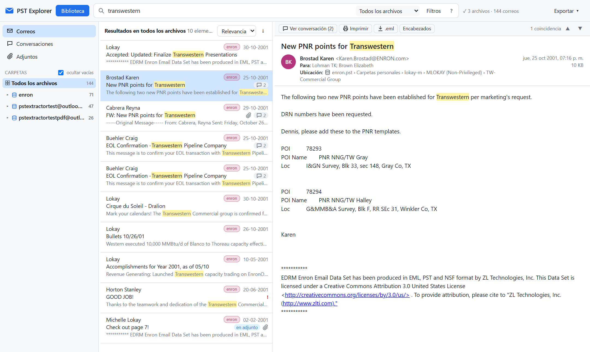

# PST Explorer

Visor local para revisar varios archivos de Outlook **.pst / .ost** a la vez, pensado para archivos grandes (decenas de GB). Funciona en tu equipo (el servidor solo escucha en `127.0.0.1`) y **nunca modifica los PST**: los abre en modo de solo lectura. Nada se envía a internet.



<sub>Captura hecha con el conjunto público de correos de Enron (EDRM, ZL Technologies, CC BY 3.0) que trae la librería pst-extractor como datos de prueba.</sub>

## Instalación

Necesitas [Node.js](https://nodejs.org) 22.13 o superior (usa el SQLite que trae Node, sin compilar nada).

```bash
git clone https://github.com/flpvergara-bit/pst-explorer.git
```

```bash
cd pst-explorer
```

```bash
npm install
```

## Cómo iniciarlo

En Windows, haz doble clic en **`Iniciar PST Explorer.bat`** (instala las dependencias la primera vez si faltan): se abre el navegador en `http://localhost:8765`. Para detener la aplicación, cierra la ventana negra que abre el `.bat`.

También puedes iniciarlo desde una terminal:

```bash
npm start
```

El puerto se cambia con la variable `PORT` y la carpeta de datos con `PSTX_DATA`. Los diálogos nativos para elegir archivos y carpetas son de Windows; en otros sistemas se usa el explorador de carpetas integrado o se pega la ruta.

Si Outlook tiene abierto un PST, ese archivo está bloqueado: cierra Outlook o trabaja sobre una copia.

## Biblioteca: varios PST juntos

Con el botón **Biblioteca** agregas archivos sueltos o una carpeta completa (busca todos los `.pst`/`.ost` que contenga). Todos los archivos de la biblioteca se revisan juntos:

- **Indexado en cola, uno a la vez** (para no saturar el disco). Primero se indexan los correos de todos los archivos, del más pequeño al más grande, y después el texto de dentro de los adjuntos. Puedes navegar y buscar desde el primer momento: los resultados se completan a medida que avanza. El avance y el tiempo estimado de cada archivo se ven en la biblioteca y arriba a la derecha.
- **Índices persistentes**: cada PST tiene su propio índice en `data\index\`. Se reconoce por el **contenido** del archivo y no por su ruta, así que sigue sirviendo aunque muevas el PST de carpeta o de disco. Si el indexado se interrumpe (cierras la app, se apaga el equipo), al volver a abrirla **continúa donde quedó**. *Pausar indexado* libera el equipo cuando lo necesites.
- **Búsqueda en todos los archivos a la vez**. Cada resultado indica de qué respaldo viene, y con el selector junto al buscador puedes acotar a *Archivo actual*, *Carpeta actual* o *Carpeta y subcarpetas*.
- **Correos repetidos entre respaldos**: si el mismo correo está en varios respaldos (mismo identificador de mensaje), se muestra una sola vez y su ficha indica «También en: …». Para ver todas las copias, marca *Mostrar copias repetidas entre respaldos* en **Filtros**.
- **Conversaciones entre archivos**: un hilo reúne sus correos aunque estén repartidos en distintos respaldos.
- **Activar o desactivar** un archivo (casilla en la biblioteca) lo incluye o lo excluye de las búsquedas sin borrar su índice. Caben hasta 10 archivos activos a la vez.
- **Disco desconectado**: si un PST no está disponible (por ejemplo, en un disco externo), igual puedes buscar en su índice y ver los datos del correo; para abrir el cuerpo completo y los adjuntos hay que conectar el disco.
- **Elementos dañados**: si un correo dañado hace caer al lector, el indexado se reanuda solo, salta ese elemento y lo cuenta como «ilegible».

## Qué hace

- **Carpetas, correos, conversaciones y adjuntos**: árbol con cada archivo y sus carpetas, lista virtual (aguanta cientos de miles de elementos), vista agrupada por conversación y una vista con todos los adjuntos, que se pueden filtrar por tipo o nombre.
- **Visor**: cuerpo HTML, RTF o texto. Muestra las imágenes incrustadas y bloquea las imágenes externas (puedes mostrarlas con un clic). Permite abrir correos que vienen adjuntos dentro de otros correos y ver los encabezados de Internet.
- **Adjuntos**: descargarlos uno a uno, ver PDF e imágenes en el navegador, bajar un ZIP con los de un correo o de una conversación, o marcar varios y bajarlos juntos.
- **Imprimir / PDF**: un correo, una conversación completa o los resultados de una búsqueda, con encabezados (De, Para, CC, fecha, adjuntos, archivo y carpeta de origen).
- **Exportar** lo que esté filtrado en ese momento: listado CSV para Excel (separado por `;`, con columna de archivo de origen), todos los adjuntos en un ZIP (por correo o en una sola carpeta) y los correos como `.eml` en un ZIP, respetando archivo y carpetas.

## Búsqueda

No distingue mayúsculas ni tildes, y cada palabra encuentra también sus terminaciones (*factura* encuentra *facturas* y *facturación*). Busca en el asunto, el remitente, los destinatarios, el cuerpo, los nombres de los adjuntos **y el texto dentro de los adjuntos**: PDF, Word, Excel, PowerPoint, TXT/CSV/XML/HTML y correos adjuntos.

| Escribe | Encuentra |
|---|---|
| `factura marzo` | correos con ambas palabras |
| `"orden de compra"` | la frase exacta |
| `pago OR transferencia` | correos con cualquiera de las dos |
| `cotización -borrador` | excluye *borrador* |
| `de:juan`, `para:maria`, `asunto:contrato`, `cuerpo:urgente` | busca en ese campo |
| `adjunto:pdf` | el nombre del archivo adjunto |
| `contenido:"123456"` | solo dentro del contenido de los adjuntos |

El panel **Filtros** agrega rangos de fecha, el tipo de adjunto, solo no leídos, solo correos y la opción de mostrar copias repetidas. Las coincidencias aparecen resaltadas en la lista y en el correo (▲▼ salta entre ellas). Los resultados que solo coinciden dentro de un adjunto llevan la etiqueta «en adjunto». Con muchísimos resultados, el total se muestra primero como «más de 5.000» y el número exacto llega un instante después.

Límites: los PDF escaneados (imágenes sin texto) no se pueden buscar porque no hay OCR. Tampoco encuentra un número escrito dentro de otra palabra (por ejemplo `12345` dentro de `INV12345`), pero sí lo encuentra escribiendo `inv12345`.

Atajos: `/` o `Ctrl+F` para ir al buscador, ↑/↓ para recorrer la lista, `Enter` para abrir la conversación y `Ctrl+P` para imprimir.

## Cómo funciona

- Servidor Node.js local ([Express](https://expressjs.com)) e interfaz web sin frameworks (`public/`).
- Lectura de PST/OST con [pst-extractor](https://github.com/epfromer/pst-extractor), más una caché de páginas y una corrección para tablas con miles de destinatarios (`src/pstcache.js`).
- Un índice SQLite con búsqueda de texto completo FTS5 por archivo (`src/indexer.js`, que corre en un proceso aparte). Las consultas combinan los índices con `ATTACH` (`src/query.js`) y `src/consolidate.js` detecta las copias entre respaldos.
- Texto de adjuntos: [pdf.js](https://mozilla.github.io/pdf.js/) para PDF y [fflate](https://github.com/101arrowz/fflate) para Word, Excel y PowerPoint.
- Seguridad: el cuerpo de cada correo se muestra en un iframe aislado con una política de contenido (CSP) que bloquea scripts e imágenes externas, y el servidor rechaza peticiones de otros orígenes.

## Privacidad

La carpeta `data/` guarda los índices, que contienen el texto de los correos, y la lista de archivos de la biblioteca. Está excluida del repositorio (`.gitignore`); no la compartas.

## Licencia

[MIT](LICENSE)
