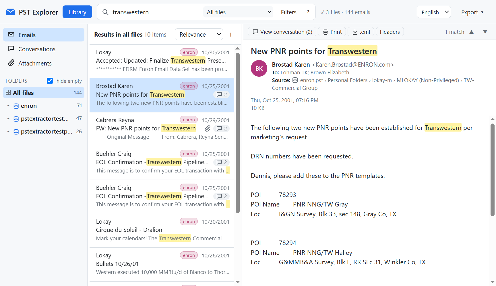

# PST Explorer

Local viewer to browse several Outlook **.pst / .ost** files at once, built for large files (tens of GB). It runs on your computer (the server only listens on `127.0.0.1`) and **never modifies the PSTs**: it opens them read-only. Nothing is sent to the internet.



<sub>Screenshot made with the public Enron email set (EDRM, ZL Technologies, CC BY 3.0) that ships with the pst-extractor library as test data.</sub>

## Installation (Windows, recommended)

1. Download **`PST-Explorer-Setup-x.y.z.exe`** from [Releases](https://github.com/flpvergara-bit/pst-explorer/releases/latest).
2. Run it. It installs for your user only (no administrator rights needed) and creates Start menu and Desktop shortcuts. The installer is available in English and Spanish.
3. Open **PST Explorer** and add your files from **Library**.

The installer is not digitally signed yet, so the first time Windows SmartScreen may show "Windows protected your PC". Click **More info → Run anyway**.

**What the desktop app offers:**
- Its own window, with native dialogs to choose files and folders.
- **Tray icon.** If you close the window while indexing, the app keeps working in the background, notifies you when it finishes and keeps the computer from going to sleep. *Quit* from the icon closes it completely.
- **Automatic updates.** New versions download by themselves and install when the app restarts; never in the middle of indexing.
- Right-click a `.pst` → **Open with → PST Explorer** adds it to the library. The default association with Outlook is not changed.
- Indexes are stored in `%APPDATA%\PST Explorer\data`, are kept when updating or reinstalling, and can be opened from *File → Open data folder*.
- **Language: English (default) or Spanish.** Change it with the selector in the top bar or in *View → Language*. The choice is saved next to the library and also applies to menus, printing, exports and file names. Search field prefixes work in both languages (`from:`/`de:`, `to:`/`para:`, `subject:`/`asunto:`, `body:`/`cuerpo:`, `attachment:`/`adjunto:`, `content:`/`contenido:`).

**If you already used the web version**, the app detects your previous library the first time it opens. It **copies and verifies it** (checks that every copied file is identical and the integrity of every index), so there is no need to re-index. The original folder stays intact until you delete it from **Library**. Close the web version before importing.

## Web version (from source)

You need [Node.js](https://nodejs.org) 22.13 or later (it uses the SQLite built into Node, nothing to compile).

```bash
git clone https://github.com/flpvergara-bit/pst-explorer.git
```

```bash
cd pst-explorer
```

```bash
npm install
```

On Windows, double-click **`Start PST Explorer.bat`** or run `npm start`: the browser opens at `http://localhost:8765`. To stop it, close the console window. The port is set with the `PORT` variable and the data folder with `PSTX_DATA`.

To work on the desktop app: `npm run app` opens it with Electron and `npm run dist` builds the installer in `dist/`. To publish a version, push a `vX.Y.Z` tag and the GitHub Actions workflow builds the installer and publishes it to Releases, from where the installed app updates itself.

If Outlook has a PST open, that file is locked: close Outlook or work on a copy.

## Library: several PSTs together

With the **Library** button you add single files or a whole folder (it finds every `.pst`/`.ost` inside it). All files in the library are reviewed together:

- **Queued indexing, one file at a time** (so the disk is not overloaded). First the emails of all files are indexed, from the smallest to the largest, then the text inside the attachments. You can browse and search from the start: results fill in as it progresses. Progress and estimated time for each file are shown in the library and at the top right.
- **Persistent indexes**: each PST has its own index in `data\index\`. It is recognized by the file **content**, not its path, so it keeps working even if you move the PST to another folder or drive. If indexing is interrupted (you close the app, the computer shuts down), it **resumes where it stopped** when you open it again. *Pause indexing* frees the computer when you need it.
- **Search across all files at once**. Each result shows which backup it comes from, and the selector next to the search box narrows it to *Current file*, *Current folder* or *Folder and subfolders*.
- **Emails repeated across backups**: if the same email is in several backups (same message identifier), it is shown once and its details say "Also in: …". To see every copy, tick *Show duplicate copies across backups* in **Filters**.
- **Compare files** (Library → *Compare files…*, or the **Export** menu): for each PST it shows how many items are not in any other backup (unique information), how many have a copy elsewhere and how many are repeated inside the same file, plus an overlap table between every pair. If a file has nothing unique, it says it can be discarded and which other files must be kept. *View unique* shows only those items in the list, which can then be exported (CSV, .eml, attachments). Duplicate = same message identifier. The app never modifies or deletes the PSTs.
- **Conversations across files**: a thread gathers its emails even when they are spread over different backups.
- **Enabling or disabling** a file (checkbox in the library) includes it in or excludes it from searches without deleting its index. Up to 10 files can be active at once.
- **Disconnected drive**: if a PST is not available (for example, on an external drive), you can still search its index and see the email details; to open the full body and the attachments, connect the drive.
- **Damaged items**: if a damaged email crashes the reader, indexing resumes by itself, skips that item and counts it as "unreadable".

## Features

- **Folders, emails, conversations and attachments**: a tree with each file and its folders, a virtual list (handles hundreds of thousands of items), a view grouped by conversation and a view with every attachment, filterable by type or name.
- **Viewer**: HTML, RTF or plain-text body. Shows embedded images and blocks external images (you can show them with one click). Opens emails attached inside other emails and shows the Internet headers.
- **Attachments**: download them one by one, view PDFs and images in the browser, get a ZIP with those of an email or a conversation, or tick several and download them together.
- **Print / PDF**: an email, a whole conversation or the results of a search, with headers (From, To, CC, date, attachments, source file and folder).
- **Export** whatever is currently filtered: a CSV list for Excel (`;`-separated, with a source-file column), all attachments in a ZIP (by email or in a single folder) and the emails as `.eml` files in a ZIP, keeping files and folders.

## Search

It ignores case and accents, and each word also matches longer forms (*invoice* finds *invoices* and *invoiced*). It searches the subject, sender, recipients, body, attachment names **and the text inside attachments**: PDF, Word, Excel, PowerPoint, TXT/CSV/XML/HTML and attached emails.

| Type | Finds |
|---|---|
| `invoice march` | emails with both words |
| `"purchase order"` | the exact phrase |
| `payment OR transfer` | emails with either of the two |
| `quote -draft` | excludes *draft* |
| `from:john`, `to:mary`, `subject:contract`, `body:urgent` | searches in that field |
| `attachment:pdf` | the attachment file name |
| `content:"123456"` | only inside the content of attachments |

The **Filters** panel adds date ranges, attachment type, unread only, emails only and the option to show duplicate copies. Matches are highlighted in the list and in the email (▲▼ jumps between them). Results that only match inside an attachment carry the "in attachment" tag. With a huge number of results, the total is shown first as "more than 5,000" and the exact number arrives a moment later.

Limits: scanned PDFs (images without text) cannot be searched because there is no OCR. It also does not find a number written inside another word (for example `12345` inside `INV12345`), but it does find it by typing `inv12345`.

Shortcuts: `/` or `Ctrl+F` to go to the search box, ↑/↓ to move through the list, `Enter` to open the conversation and `Ctrl+P` to print.

## How it works

- Local Node.js server ([Express](https://expressjs.com)) and a framework-free web UI (`public/`). In the desktop app ([Electron](https://www.electronjs.org), `electron/`), the same server runs as a separate process on a free port, protected with a session token, and the window loads that UI.
- PST/OST reading with [pst-extractor](https://github.com/epfromer/pst-extractor), plus a page cache and a fix for tables with thousands of recipients (`src/pstcache.js`).
- One SQLite index with FTS5 full-text search per file (`src/indexer.js`, which runs in a separate process). Queries combine the indexes with `ATTACH` (`src/query.js`) and `src/consolidate.js` finds the copies across backups and builds the file comparison.
- Attachment text: [pdf.js](https://mozilla.github.io/pdf.js/) for PDF and [fflate](https://github.com/101arrowz/fflate) for Word, Excel and PowerPoint.
- Translations: `public/i18n.js` (web UI) and `src/i18n.js` (server and desktop app), in English and Spanish.
- Security: each email body is shown in an isolated iframe with a content security policy (CSP) that blocks scripts and external images, and the server rejects requests from other origins.

## Privacy

The `data/` folder stores the indexes, which contain the text of the emails, and the list of files in the library. It is excluded from the repository (`.gitignore`); do not share it.

## License

[MIT](LICENSE)
